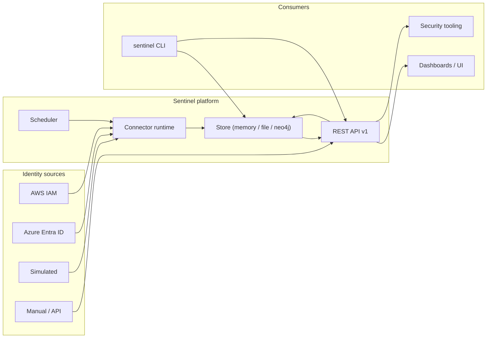
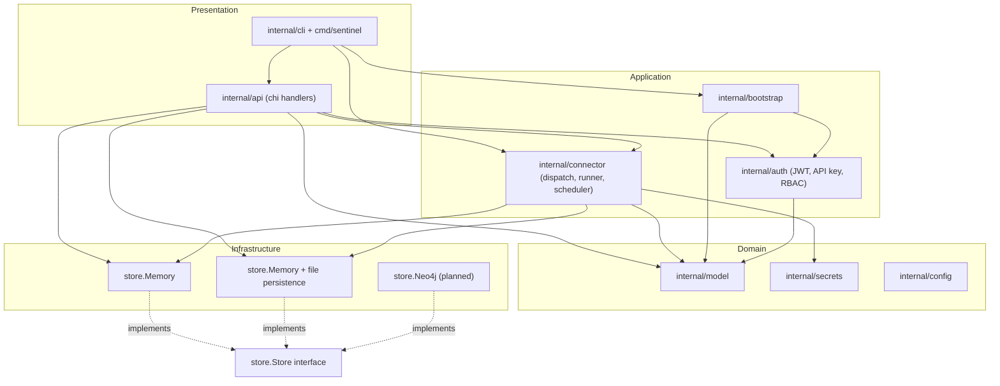
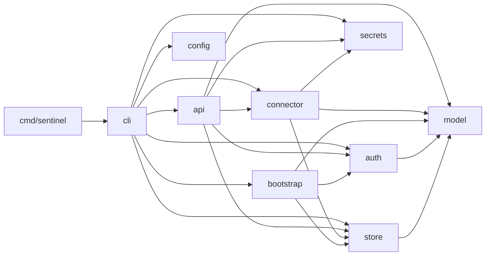
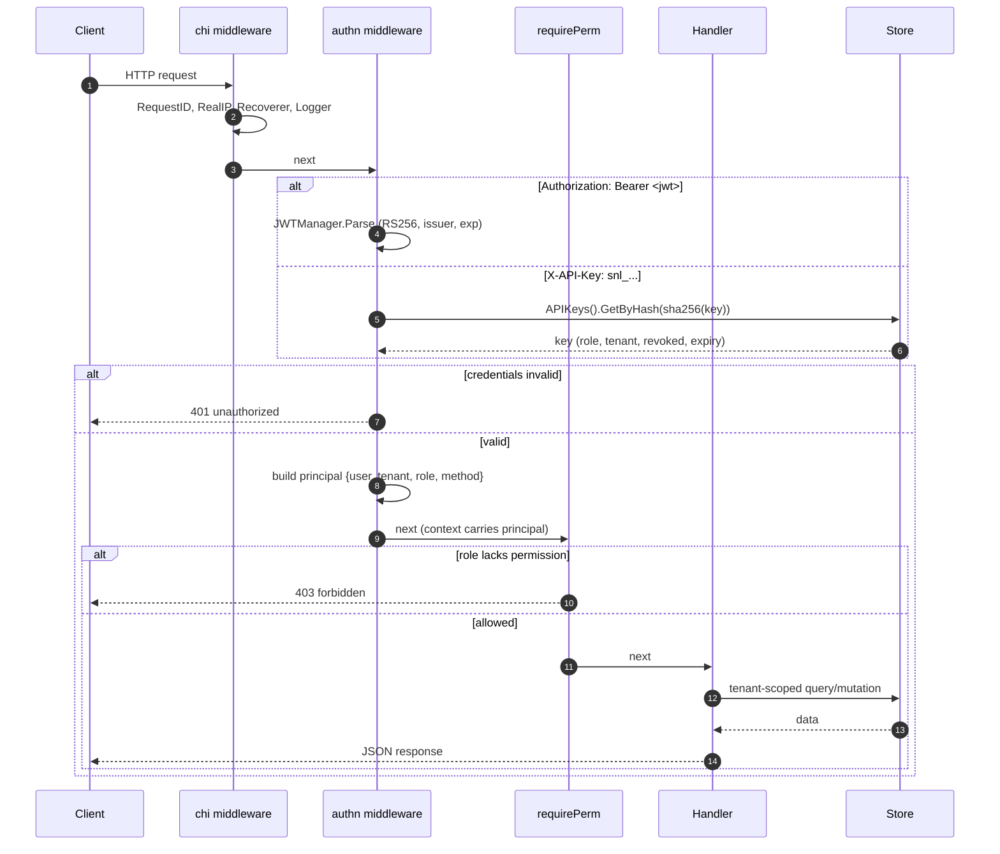
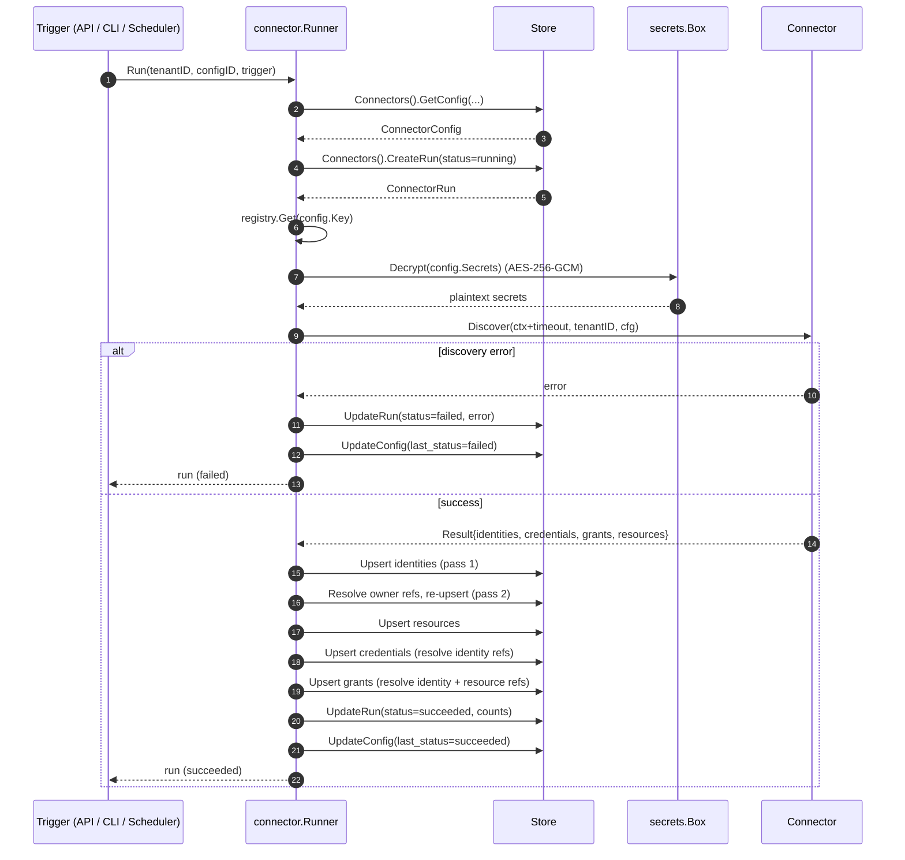
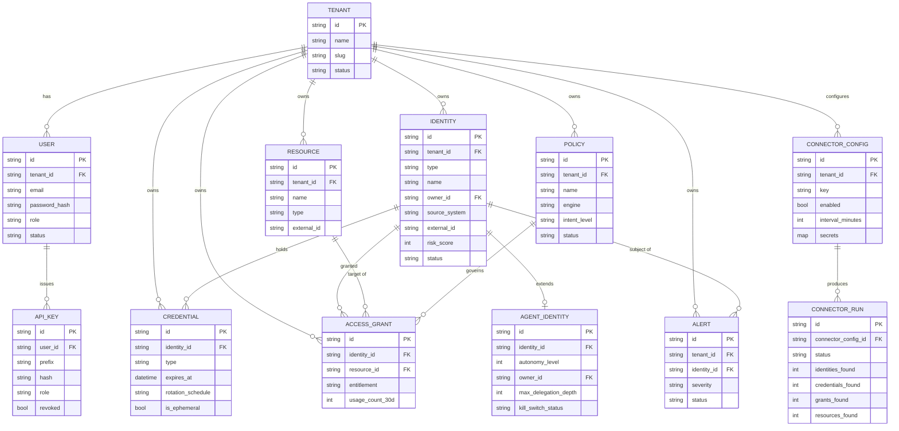
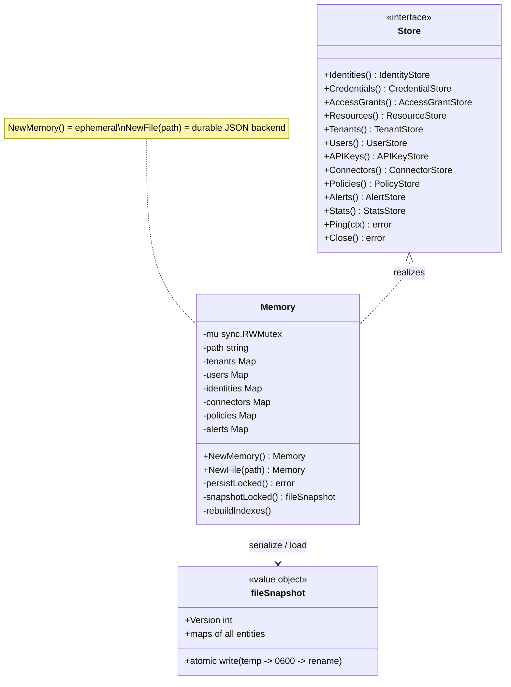
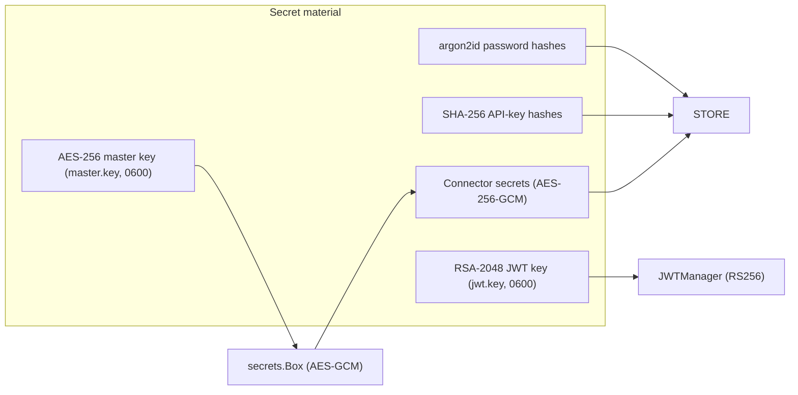
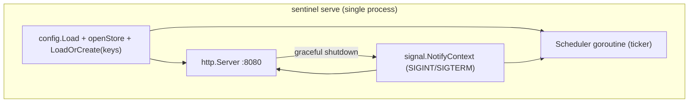

# Sentinel — Architecture

This document describes the structure, runtime behaviour and data model of
Sentinel. All diagrams are [Mermaid](https://mermaid.js.org/) and render on
GitHub (and most Markdown viewers).

---

## 1. System context

Sentinel sits between external identity sources and the governance consumers
(analysts, security tooling, dashboards). It normalises everything into one
identity graph and exposes it over a REST API.

---

## 2. Layered architecture

Sentinel is a single Go module (`github.com/sentinel-iam/sentinel`) with a
strict dependency direction: `api` and `connector` depend on `store`, `model`,
`auth`, `secrets`; the concrete store depends only on `model`.

---

## 3. Module dependency graph

No package imports `api` or `cli`, keeping the core reusable and testable.

---

## 4. Request lifecycle (authentication + RBAC)

Every `chi` request passes through recovery, logging, authentication and a
per-route permission guard before reaching a handler.

---

## 5. Connector run lifecycle

A run can be triggered manually (`POST /connectors/{id}/run`), by the CLI, or by
the scheduler. The `Runner` owns orchestration and bookkeeping.

The external-reference resolver lets connectors express relationships by
source-system external id (e.g. `sim:role:billing-writer`) which the runner maps
to internal UUIDs after upserting the referenced records.

### AWS IAM mapping

The `aws_iam` connector (see `docs/connector-aws-iam.md`) maps AWS resources onto
the unified model:

| AWS resource | Sentinel model |
| --- | --- |
| IAM **user** | `Identity { human }` |
| IAM **role** | `Identity { workload }` |
| IAM **group** | `Identity { team }` |
| **access key** (active + last-used metadata) | `Credential { access_key }` |
| IAM **policy** attached to a user/role/group | `Resource` + `AccessGrant` (the policy as resource, the attachment as grant) |
| **account ID / MFA state** | identity attributes |

Pagination is handled via AWS SDK v2 `List*Pages`; per-account discovery uses a
read-only credential resolved through the standard AWS credential provider chain.

---

## 6. Data model

Core entities and their relationships. All records are tenant-scoped except
`Tenant` itself.

### Identity types

`human`, `workload`, `service_account`, `api_key`, `oauth_token`, `ai_agent`,
`mcp_server`, `device`, `certificate`, `team`.

### Credential types

`password`, `api_key`, `access_key`, `oauth_token`, `certificate`,
`service_account_key`, `ssh_key`, `federated`.

---

## 7. Store abstraction

One interface, multiple backends. The file backend reuses the in-memory
implementation and adds an atomic JSON persistence hook on every mutation.

### Persistence guarantees

- **Atomic writes** — snapshot is marshalled to a temp file in the same
  directory, chmod `0600`, then `os.Rename`d over the target.
- **Durability on mutation** — every successful write operation persists the
  full snapshot before returning (errors propagate to the caller).
- **Index rebuild on load** — `identityExt`, `resourceExt`, `userEmail`,
  `apiKeyHash`, `tenantSlug` are derived from primary maps, so the on-disk
  format stays minimal.
- **Sensitive fields** — `password_hash`, API-key `hash`, and connector
  `secrets` are carried in dedicated snapshot records; connector secrets are
  always stored **encrypted** (the API encrypts before writing).

---

## 8. Security model

- Passwords: **argon2id** (`m=64MiB, t=3, p=4`, 32-byte key).
- API keys: random 32 bytes, `snl_` prefix, **SHA-256** hash stored; compared by
  lookup, revoked/expiry enforced.
- JWTs: **RS256**, issuer + expiry validated, `alg` confusion guarded.
- Connector secrets: **AES-256-GCM** with a per-install key; ciphertext only on
  disk.
- RBAC: role→permission matrix enforced by middleware on every route.

---

## 9. Startup & runtime topology

Graceful shutdown drains the HTTP server (10s) before exit; the scheduler stops
when the context is cancelled.

---

## 10. Extensibility

| Extension point | How |
| --- | --- |
| New identity source | Implement `connector.Connector`, register in `connector.Default()`. |
| New storage backend | Implement `store.Store`, select via `SENTINEL_STORE`. |
| New permission | Add a `Perm*` constant and wire it into `rolePermissions` and a route. |
| Policy engines | Populate `Policy.Engine`; the engine hook is reserved for evaluation. |
| Alert generation | Write to `Alerts()` from a future evaluation component. |

The `aws_iam` connector key is implemented and registered by default; the
`azure_entra` key remains reserved and returns a "not implemented" error until a
`Connector` is registered for it.

---

## 11. Operational endpoints

The HTTP server exposes a set of non-versioned endpoints for operations and
developer experience in addition to the versioned `/v1/*` API:

| Endpoint | Purpose |
| --- | --- |
| `GET /healthz` | Liveness probe — always 200 when the process is up. |
| `GET /readyz` | Readiness probe — 200 once wiring is complete. |
| `GET /metrics` | Prometheus text exposition format (global HTTP + internal counters). |
| `GET /openapi.yaml` | The canonical OpenAPI 3.1 specification for the `/v1` API. |
| `GET /docs` | Swagger UI (loaded from a pinned CDN) bound to `openapi.yaml`. |

The OpenAPI spec is embedded into the binary via `go:embed` and is the
source of truth for request/response shapes and query parameters; the automated
spec validation runs against it in CI. The `/docs` route relaxes the
Content-Security-Policy header enough to load the Swagger UI bundle; every other
route keeps the strict default policy.
