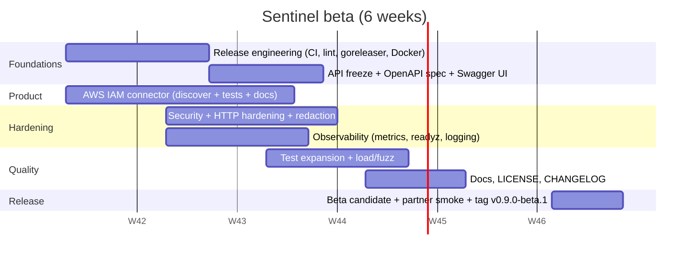

# Sentinel — Beta Release Plan

| Field | Value |
| --- | --- |
| Target | `v0.9.0-beta.1` |
| Audience | Invited design partners (gated) |
| Connector scope | `simulated` + **AWS IAM** (real) |
| Distribution | GitHub Releases (goreleaser binaries) + container image |
| API docs | OpenAPI 3.1 spec + Swagger UI |
| License | Apache-2.0 |
| Status | Approved |

## 1. Objectives

1. Ship a runnable, installable beta that lets a design partner discover **real AWS IAM** identities/credentials/grants and view the governance overview.
2. Freeze the `/v1` API surface and publish a machine-readable OpenAPI spec.
3. Harden security, observability and reliability to a supportable bar.
4. Stand up release engineering (CI, reproducible builds, signed artifacts, container).

## 2. Exit criteria (beta is done when)

- [ ] AWS IAM connector discovers users, roles, groups, access keys, policies and MFA state against a real sandbox account; secrets never logged/returned.
- [ ] `openapi.yaml` validates and documents every `/v1` route; Swagger UI reachable.
- [ ] CI green on Linux/macOS/Windows: `gofmt`, `go vet`, `golangci-lint`, `gosec`, `govulncheck`, `go test -race`, coverage gates.
- [ ] No open P0/P1 defects; no high/critical vulnerabilities.
- [ ] Cross-platform binaries + container image published with checksums and SBOM.
- [ ] Docs complete: getting started, AWS IAM guide, operations, security, API.
- [ ] Fresh-install and file-store upgrade smoke tests pass.

## 3. Scope

**In scope:** AWS IAM connector, OpenAPI spec + Swagger UI, metrics/health, login rate-limiting, HTTP server hardening, secret redaction, CI/CD, goreleaser, Dockerfile, LICENSE, CHANGELOG, docs set.

**Out of scope (GA backlog):** Neo4j store, Azure Entra connector, policy evaluation engine, alert generation, agent-identity endpoints, SSO/OIDC login, web UI, HA/multi-region.

## 4. Milestones

### M0 — Foundations (W1–W2)
- [ ] `Makefile`/`Taskfile` with `build`, `test`, `lint`, `race`, `coverage`, `release` targets.
- [ ] `.github/workflows/ci.yml` — matrix (Ubuntu/macOS/Windows), Go 1.27, gofmt check, `go vet`, `golangci-lint`, `gosec`, `govulncheck`, `go test -race`, coverage upload.
- [ ] `.golangci.yml` config.
- [ ] `LICENSE` (Apache-2.0).
- [ ] `CHANGELOG.md` (Keep a Changelog) seeded with existing work.

### M1 — Release engineering (W2–W3)
- [ ] `.goreleaser.yaml` — linux/darwin/windows × amd64/arm64, archives, `checksums.txt`, changelog, SBOM (syft).
- [ ] Inject `version/commit/date` via ldflags into `github.com/sentinel-iam/sentinel/internal/cli` (verify `sentinel version` reports them).
- [ ] `.github/workflows/release.yml` — trigger on `v*` tag → goreleaser + container publish.
- [ ] `Dockerfile` — multi-stage, distroless/alpine, non-root, `HEALTHCHECK` on `/healthz`.
- [ ] `docker-compose.yml` example (file store volume, env).

### M2 — API freeze & OpenAPI (W3–W4)
- [ ] Freeze `/v1`; document stability + deprecation policy.
- [ ] `openapi/openapi.yaml` (OpenAPI 3.1): all routes, schemas, security schemes (Bearer + `X-API-Key`), error envelope, pagination.
- [ ] Serve Swagger UI at `/docs` (behind a dev flag) or publish standalone.
- [ ] CI step: validate spec (spectral) and, optionally, contract-test responses.

### M3 — AWS IAM connector (W1–W3)
- [ ] Re-add AWS SDK v2 deps (`config`, `iam`, `sts`); least-privilege read-only policy doc.
- [ ] `internal/connector/aws_iam.go`: `Key() = model.ConnectorAWSIAM`; auth via access key/secret (+optional session token, assume-role, external ID); config from encrypted `ConnectorConfig.Secrets`.
- [ ] Discovery mapping:
  - IAM **users** → `Identity{human}`
  - IAM **roles** → `Identity{workload}`
  - IAM **groups** → `Identity{team}` / `Resource`
  - **access keys** → `Credential{access_key}` (+last used/created)
  - **attached/inline policies** → `AccessGrant{entitlement}` + `Resource{policy/*}`
  - account alias/tags + MFA flags
- [ ] Pagination, retries/backoff, context timeout, error mapping.
- [ ] External-ref resolver: identity/resource external id = ARN.
- [ ] Unit tests with a mocked IAM client interface; integration test gated by env credentials.
- [ ] `docs/connector-aws-iam.md` with least-privilege policy JSON.

### M4 — Security hardening (W2–W3)
- [ ] Login rate-limiting + brute-force lockout; optional global limiter.
- [ ] HTTP server timeouts (`ReadHeaderTimeout`, `ReadTimeout`, `WriteTimeout`, `IdleTimeout`) + body size limit.
- [ ] Secret redaction: connector `secrets` on read; redaction tests.
- [ ] Reject default/weak bootstrap password; password strength check.
- [ ] Optional CORS (off by default); security headers.
- [ ] JWT hardening review (alg=none guard, clock skew, key size).
- [ ] `docs/security.md` (threat model + key/rotation procedures).

### M5 — Observability & ops (W2–W3)
- [ ] `/metrics` (Prometheus): request count/latency, connector runs/durations, scheduler ticks, store records.
- [ ] `/readyz` (store `Ping`) separate from `/healthz` (liveness).
- [ ] Structured logging goals aligned to `SENTINEL_LOG_LEVEL`; request-id propagation verified.
- [ ] Startup config validation with clear errors; graceful-shutdown verification (no dropped runs).
- [ ] `docs/operations.md`: backup/restore, file-store limits, systemd unit.
- [ ] Example `contrib/sentinel.service`.

### M6 — Quality (W3–W5)
- [ ] Add tests: `connector` runner ref-resolution + scheduler, `bootstrap` idempotency, `aws_iam` (mocks), file-store concurrent writes, `secrets.Box`, `model` validation.
- [ ] Coverage gates (suggest ≥70% overall, ≥80% `auth`/`store`).
- [ ] Fuzz targets: `VerifyPassword`, snapshot `loadSnapshot`.
- [ ] Load test (k6/vegeta): login + `GET /identities` + `/stats/overview`; record p95 target.
- [ ] Manual exploratory checklist.

### M7 — Docs & beta program (W4–W6)
- [ ] `README.md` beta quickstart + AWS IAM section; update `ARCHITECTURE.md` (AWS IAM, metrics, OpenAPI).
- [ ] `CONTRIBUTING.md`, `SECURITY.md`, `CODE_OF_CONDUCT.md`; issue/feedback templates.
- [ ] Opt-in telemetry only (off by default); privacy note.
- [ ] Tag `v0.9.0-beta.1`, publish release notes + known limitations; partner triage board.

## 5. Definition of Done (per workstream)

- Consistent error envelope and status codes verified.
- Tests + race + lint + vuln scan green in CI.
- Docs updated in the same change as the feature.
- No secrets in logs, responses, or the persisted snapshot.

## 6. Risks & mitigations

| Risk | Impact | Mitigation |
| --- | --- | --- |
| AWS IAM permission/edition variance | Connector failures across accounts | Minimal read-only policy, mocks, sandbox matrix |
| API churn during beta | Partner rework | Freeze `/v1`; deprecation policy |
| Secret leakage | Security incident | Redaction tests, gosec, review gate |
| File-store scalability limits | Poor UX at scale | Document limits; load test; Neo4j next |
| Scope creep (Azure/engine) | Missed beta date | Hard out-of-scope list; defer to GA |

## 7. Post-beta / GA backlog

Neo4j store · Azure Entra connector · policy engine · alert generation · agent-identity governance · SSO/OIDC login · web UI · HA.
